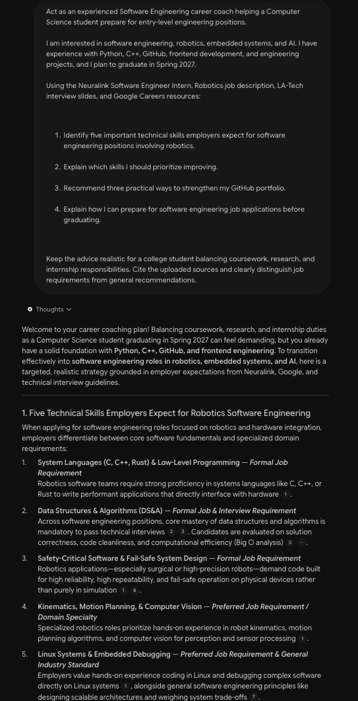
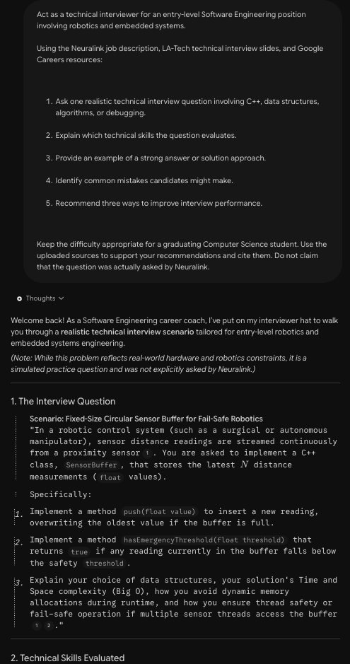
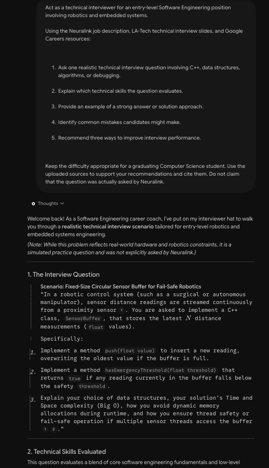

# AI Software Engineering Career Coach

## 1. Project Overview

The AI Software Engineering Career Coach is an AI-powered career guidance assistant that I created using Google NotebookLM as part of the LA-Tech.org Rising Technical Internship Program and AI Pre-Apprenticeship Capstone

The assistant is designed to help Computer Science students and aspiring software engineers prepare for careers in software engineering, robotics, embedded systems, and AI

By using credible career resources and job descriptions, the assistant provides personalized career guidance, technical interview preparation, and structured career development plans

**Career Pathway:** Software Engineering

**Built With:** Google NotebookLM

**Program:** LA-Tech.org Rising Technical Internship Program, Fall 2026

## 2. Problem and Goal

Preparing for a software engineering career can be challenging, especially for students who are balancing coursework, internships, research, and personal projects

There are many different technical skills employers look for, and it can be difficult to know which ones to prioritize or how to prepare for interviews

I wanted to create an AI Career Coach that could help students better understand industry expectations and organize their career preparation

The main goals of this assistant are to:

- Identify important technical skills for software engineering positions
- Provide career guidance based on credible sources
- Help students prepare for technical and behavioral interviews
- Recommend ways to improve GitHub portfolios and technical projects
- Create realistic career development plans
- Encourage responsible use of AI-generated information

## 3. Tools and Sources

### Tools Used

- Google NotebookLM for building and testing the AI Career Coach
- GitHub for documenting the project and sharing the results
- Markdown for organizing the project documentation
- Prompt engineering techniques for improving AI responses

### Sources Used

I uploaded three career-related resources into NotebookLM to help the assistant provide more relevant and source-grounded responses

**1. Neuralink — Software Engineer Intern, Robotics**

A target job description used to identify technical skills and qualifications for robotics software engineering positions

The resource helped the assistant identify areas such as C++, Linux, robotics software, embedded systems, and software reliability

**2. LA-Tech.org — Technical Interview Preparation**

Technical interview preparation materials provided during the LA-Tech.org Rising Technical Internship Program

These materials cover:

- Data structures and algorithms
- Technical interview preparation
- Problem-solving techniques
- Coding interview expectations
- Time and space complexity
- Mock interview practice

**3. Google Careers — Technical Interview and Career Resources**

Career development resources used to explore software engineering interview preparation, technical expectations, and professional development

These sources helped the assistant provide more specific recommendations instead of relying only on general AI generated information

## 4. How It Works

The AI Software Engineering Career Coach uses Google NotebookLM to analyze uploaded career resources and answer questions based on those materials

The process involves:

1. Uploading credible career resources and job descriptions into NotebookLM
2. Asking questions related to software engineering career preparation
3. Using role based and structured prompts to guide the assistant
4. Reviewing AI generated responses and their source citations
5. Improving prompts to receive more relevant and organized answers
6. Evaluating the responses for accuracy and responsible AI use

The assistant does not require a separate application or custom machine learning model because NotebookLM provides the AI functionality

## 5. Examples and Screenshots

I tested my AI Career Coach using three prompts focused on career guidance, technical interview preparation, and career planning

### Example 1: Career Guidance

**Prompt:**

Act as an experienced Software Engineering career coach helping a Computer Science student prepare for entry level engineering positions

I am interested in software engineering, robotics, embedded systems, and AI. I have experience with Python, C++, GitHub, frontend development, and engineering projects, and I plan to graduate in Spring 2027

Using the uploaded career resources:

1. Identify five important technical skills employers expect for software engineering positions involving robotics
2. Explain which skills I should prioritize improving
3. Recommend three practical ways to strengthen my GitHub portfolio
4. Explain how I can prepare for software engineering job applications before graduating

Keep the advice realistic for a college student balancing coursework, research, and internship responsibilities. Cite the uploaded sources

**What I Learned:**

The assistant identified important technical skills such as C++, data structures, algorithms, Linux, and embedded systems

It also recommended improving my GitHub documentation, practicing technical interviews, and gaining more experience with low-level programming

This helped me better understand how my current technical experience connects to software engineering positions and what I should continue improving

**Screenshot:**

### Example 2: Mock Technical Interview

**Prompt:**

Act as a technical interviewer for an entry level Software Engineering position involving robotics and embedded systems

Using the uploaded job description and interview preparation resources:

1. Ask one realistic technical interview question involving C++, data structures, algorithms, or debugging
2. Explain which technical skills the question evaluates
3. Provide an example of a strong answer or solution approach
4. Identify common mistakes candidates might make
5. Recommend three ways to improve interview performance

Keep the difficulty appropriate for a graduating Computer Science student and cite the uploaded sources

**What I Learned:**

The assistant generated a C++ technical interview question involving a fixed-size circular sensor buffer for a robotic system

It provided sample code and explained memory management, data structures, Big O complexity, and thread safety

I learned how technical interviews can test both programming knowledge and the ability to explain engineering decisions

I also noticed that AI-generated code should still be reviewed because the example did not fully address certain edge cases, such as invalid buffer sizes and sensor readings

**Screenshot:**

### Example 3: 30/60/90-Day Career Action Plan

**Prompt:**

Act as a Software Engineering career mentor helping a Computer Science student prepare for entry level engineering opportunities

I plan to graduate in Spring 2027 and am interested in software engineering, robotics, embedded systems, and AI

Using the uploaded career resources, create a realistic 30/60/90-day career development plan

Organize the plan into three stages:

- Days 1–30: Identify technical skill gaps, improve GitHub documentation, and begin interview preparation
- Days 31–60: Practice coding interviews, strengthen an existing engineering project, and research job opportunities
- Days 61–90: Apply for relevant positions, complete mock interviews, and evaluate progress

For each stage, provide three specific actions, one measurable goal, a recommended resource, and a way to track progress

Keep the plan manageable alongside college coursework, research, and internship responsibilities

**What I Learned:**

The assistant created a structured career plan with specific activities and measurable goals

It recommended improving my GitHub portfolio, practicing C++ programming and coding interviews, and preparing job applications

I found this useful because it organized career preparation into smaller steps that I could realistically work on while finishing my degree

**Screenshot:**

## 6. Testing and Improvements

### Original Prompt

Give me advice on getting a software engineering job

### Improved Prompt

Act as a Software Engineering career coach helping a Computer Science student graduating in Spring 2027

Using the uploaded Neuralink robotics software engineering job description, Google Careers resources, and LA-Tech interview preparation slides:

1. Identify three technical skills I should prioritize before graduation
2. Recommend one practical activity for improving each skill
3. Explain how each activity relates to entry level software engineering or robotics positions
4. Present the recommendations in a table

Keep the advice realistic for someone balancing college coursework, research, and an internship. Cite the uploaded sources and do not invent qualifications or accomplishments

### What Changed and Why

I first tested my AI Career Coach with a general question asking for advice on getting a software engineering job. The response was helpful, but it covered several different areas without giving me a clear order of what to focus on.

I improved the prompt by adding more context about my graduation timeline, career interests, and current responsibilities. I also asked the assistant to identify three important technical skills, recommend practical activities, and organize everything into a table.

The improved response was easier to follow because it gave me specific recommendations for C++, technical interviews, and GitHub projects. It also considered my workload as a college student, which made the advice more realistic and useful.

## 7. Responsible AI

### Accuracy and Hallucination Testing

For my responsible AI test, I asked my Career Coach to explain Neuralink's exact interview process, including the number of interview rounds and specific coding questions. I wanted to see whether it would make up information that wasn't included in my uploaded sources.

The assistant correctly explained that these details couldn't be verified from the available documents. It also separated general software engineering interview practices from information specifically confirmed by Neuralink.

This test helped me understand why it's important to check AI generated information and use reliable sources instead of automatically trusting every response.

### Privacy and Responsible Use

I also considered privacy and responsible AI practices when building this project

- Avoid uploading private resumes, transcripts, and personal contact information to public repositories
- Review screenshots before sharing them publicly
- Verify AI generated technical information using credible sources
- Avoid presenting AI generated recommendations as guaranteed outcomes
- Review and test AI generated code before using it in real applications
- Recognize that AI tools can produce inaccurate or incomplete information

The NotebookLM notebook remains private, while this GitHub repository documents the project and its results

## 8. My 30/60/90-Day Career Action Plan

Based on the recommendations generated by my AI Career Coach, I created the following career development plan

### Days 1–30: Strengthen Technical Foundations

- Review C++ programming concepts, memory management, and Linux debugging
- Improve documentation for two GitHub repositories
- Practice 10 untimed data structures and algorithms problems
- Identify technical skills that need improvement

**Goal:** Improve two GitHub READMEs and complete 10 coding practice problems

### Days 31–60: Build Experience and Practice Interviews

- Complete 15 timed coding interview problems
- Improve an existing C++ or robotics project
- Research companies offering software engineering and robotics opportunities
- Practice explaining technical solutions and Big O complexity

**Goal:** Complete 15 timed coding problems and add one meaningful feature to an engineering project

### Days 61–90: Prepare for Job Applications

- Submit 15–20 tailored applications for relevant engineering positions
- Complete at least three mock technical interviews
- Review feedback from coding practice and interviews
- Track job applications and identify areas for improvement

**Goal:** Submit 15–20 applications and complete three mock interviews

### Tracking My Progress

I plan to track my progress using GitHub, coding practice logs, and a simple job application tracker

The goal is to continue improving my technical skills while maintaining a manageable schedule alongside my academic responsibilities

## 9. Reflection

### What was the most useful thing my AI Career Coach did?

The most useful part was helping me understand which technical skills I should prioritize for software engineering positions involving robotics and embedded systems. It also helped me organize my career preparation into smaller and more realistic goals.

### What was one limitation or mistake I discovered?

One limitation I noticed was that AI generated code and technical recommendations are not always complete. For example, the C++ interview solution did not fully address certain edge cases and real time system requirements. This reminded me that AI responses should be reviewed and tested before being used.

### How could this assistant help someone in a real job?

This assistant could help students and early career professionals prepare for interviews, understand technical job requirements, and identify areas where they need more experience. It could also help them organize professional development goals and improve their technical portfolios.

### What would I improve in a future version?

I would add more job descriptions from different engineering companies and expand the resources to include software engineering, robotics, embedded systems, and machine learning career pathways. I would also like to improve the interview preparation feature by testing more coding problems and evaluating the accuracy of generated solutions.

## 10. Skills Demonstrated

- Prompt Engineering
- Google NotebookLM
- AI Output Evaluation
- Responsible AI Practices
- Technical Interview Preparation
- Career Research and Planning
- GitHub Documentation
- Markdown
- Source-Grounded AI Research

## 11. Project Notes

This project was developed as part of the LA-Tech.org Rising Technical Internship Program AI Pre-Apprenticeship Capstone

The public repository contains project documentation and redacted screenshots of the AI Career Coach's responses

The original NotebookLM notebook and any private career materials are not publicly shared
